<div align="center">

# 동행 (DongHaeng)

### 전화 없이, 한 대처럼

여러 대의 현대·기아·제네시스 차를 하나의 그룹으로 묶어 위치·도착 예정·차량 상태·경로를 **실시간으로 공유**하고,<br>
운전자에게는 **음성으로** 알려 주는 Pleos 차량 앱

현대자동차그룹 차량용 앱 개발 공모전 「Code your App into Pleos App Market」 출품작

[](#테스트-환경-및-필요한-설정)


[](#apk-파일-위치)
[](#검증-결과)
[](#검증-결과)

**[차량 앱 APK](apk/DongHaeng_동행_release.apk)** · [폰 시연 앱 APK](apk/DongHaeng_동행_폰시연앱_release.apk) · [시연 영상](docs/video/DongHaeng_demo.mp4) · [실행 방법](#실행-방법) · [상세 기획서](docs/01_상세기획서_PRD.md) · [기획서 제출본](docs/12_기획서_제출본.md)

</div>

<p align="center">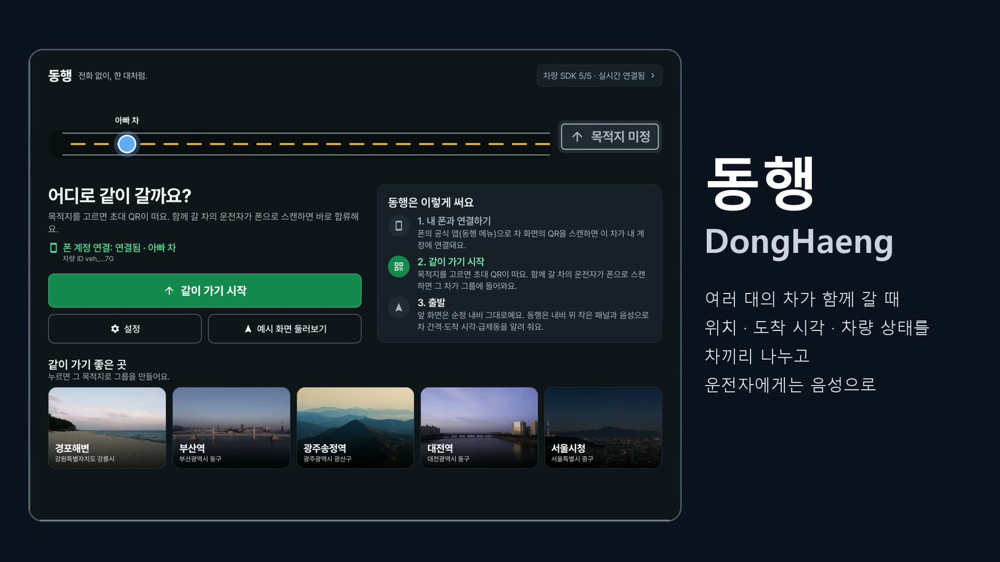</p>
<p align="center"><sub>차량 앱 홈 — 시연 영상 첫 장면(2026-11-05 녹화, 실제 앱 화면). 도로 띠 위의 내 차, 주 버튼 [같이 가기 시작], 누르면 그 목적지로 그룹을 만드는 '같이 가기 좋은 곳' 사진 줄.</sub></p>

> [!IMPORTANT]
> 동행은 **정보 공유 앱**이며 충돌 방지·안전 보조 장치가 아닙니다. 주행 중 앞 화면은 **항상 순정 내비**이고, 차량 제어(Set) API 는 쓰지 않습니다(조회만).

---

## 앱 이름 및 한 줄 소개

**동행(DongHaeng)** — 전화 없이, 한 대처럼. 여러 대의 현대·기아·제네시스 차량을 하나의 그룹으로 묶어 위치·도착 예정·차량 상태·경로를 실시간으로 공유하고 운전자에게 음성으로 알려 주는 차량 앱입니다.

- 📱 **QR 한 번으로 그룹.** 선두차 화면의 초대 QR 을 폰으로 스캔하고 함께 갈 차를 고르면 그 차 화면에 그룹이 뜹니다. 차는 QR 을 보여 주기만 합니다.
- 🛣️ **주행 중엔 순정 내비 그대로.** 동행은 내비 위 작은 패널과 음성으로만 앞뒤 차 간격·도착 시각을 알립니다.
- 🔋 **차가 대신 말합니다.** 저잔량·급제동·에어백·휴게소 도착을 사람이 말하지 않아도 차량 데이터가 그룹에 전합니다.
- 🧭 **선두 경로 따라가기.** 선두가 휴게소를 경유지로 넣으면 뒤차에 "따라갈까요?" — 수락하면 뒤차 순정 내비 경로에 그대로 들어갑니다.
- 🎙️ **핸들 버튼 무전.** 핸들 재생/정지 버튼으로 말하고 "보낼까요?"에 음성으로 답하면 그룹 차에서 바로 재생됩니다.
- 💬 **동승자 메시지.** 동승자가 폰에서 보낸 메시지를 운전자는 듣기만 합니다.
- 🅿️ **정차하면 대시보드.** 대열·그룹 도착 예상·다음 정차·최근 소식을 한 화면에서 봅니다. 조작은 정차 중에만 합니다.

| 제출물 | 위치 |
|---|---|
| 소스 코드 | 이 저장소 (`car-app/`·`companion/`·`server/`·`protocol/`·`infra/`) |
| APK (release) | [`apk/DongHaeng_동행_release.apk`](apk/DongHaeng_동행_release.apk) — 차량 앱 · [`apk/DongHaeng_동행_폰시연앱_release.apk`](apk/DongHaeng_동행_폰시연앱_release.apk) — 폰 시연 앱(QR 합류용) |
| 시연 영상 | [`docs/video/DongHaeng_demo.mp4`](docs/video/DongHaeng_demo.mp4) (2분 42초, 실제 앱 화면 녹화) |
| 서버 | 클라우드에서 동작 중 — `https://3.24.206.147.sslip.io` (따로 띄울 필요 없음) |

**검증 요약:** 시연 장면 10/10 · 무전 75/75 · release APK 흐름 12/12 · 30분 연속 실행 오류 0 — 자세한 수치는 [검증 결과](#검증-결과).

## 목차

**공모전 README 필수 항목** — ① [앱 이름 및 한 줄 소개](#앱-이름-및-한-줄-소개) · ② [실행 방법](#실행-방법) · ③ [테스트 환경 및 필요한 설정](#테스트-환경-및-필요한-설정) · ④ [APK 파일 위치](#apk-파일-위치)

**더 보기** — [문제와 접근](#문제와-접근) · [화면 둘러보기](#화면-둘러보기) · [핵심 기능](#핵심-기능) · [시스템 구조](#시스템-구조) · [Pleos SDK 활용](#pleos-sdk-활용) · [검증 결과](#검증-결과) · [만들면서 부딪힌 것들](#만들면서-부딪힌-것들) · [저장소 구조](#저장소-구조) · [한계](#한계) · [문서 지도](#문서-지도)

## 문제와 접근

### 불편한 순간

- 가족·친구가 차 2~3대로 명절 귀성·여행·캠핑·동호회 투어를 갈 때, 동승자가 전화와 메신저로 "앞차 어디야?", "휴게소 들르자"를 **중계**합니다.
- **운전자 혼자 탄 차**는 운전 중 통화가 위험해서 그룹에서 소외됩니다.
- 앞차가 경로를 바꾸면 뒤차 운전자가 **내비를 다시 입력**해야 합니다.
- 한 차의 **배터리·연료 부족, 급제동, 휴게소 도착**은 누가 말해 주기 전까지 아무도 모릅니다.

### 왜 폰이 아니라 차인가

| 상황 | 폰(전화·위치 공유 앱) | 동행 |
|---|---|---|
| 운전자 혼자인 차 | 운전 중 조작 불가 | 자동 공유 + 음성 안내 |
| 차량 상태(연료·배터리·급제동·에어백) | 사람이 말해야 앎 | 차량 데이터가 자동 전달 |
| 차 3대 이상 | 1:1 통화 중계 반복 | 그룹 전체 동시 전달 |
| 경로 변경 | 말로 듣고 내비 재입력 | 선두차 경유지를 뒤차 내비에 바로 세팅 |
| 휴게소·목적지 도착 | 누군가 확인하고 전화 | 내비 도착 이벤트로 자동 알림 |

차량 SDK(Vehicle·NaviHelper)가 이미 알고 있는 정보를 **그룹 안에서만, 이동하는 동안만** 공유합니다. 사람은 아무것도 입력하지 않고, 필요한 순간에만 음성으로 듣습니다.

### 안전 원칙

- **주행 중 앞 화면은 항상 순정 내비.** 동행은 가리지 않는 표면으로만 알립니다 — ① 내비 위 작은 플로팅 패널(내비 화면 폭의 22% 이하, 회전 안내·하단 버튼을 피함) ② 음성 ③ 그룹 휴게소를 내비 경유지로 ④ 플로팅 창 권한이 없을 때만 5초 알림 카드(다음 회전 300 m 이내면 회전 뒤로 미룸).
- **주행 중 화면 조작은 [무전] 한 번뿐**입니다(CarUxRestrictions). 보낼지 말지는 음성으로 답하고, 나머지 입력은 정차 중에만 받습니다.
- **차량 제어 기능은 쓰지 않습니다.** 경로 변경도 운전자가 수락해야만 세팅됩니다.
- **위치는 그룹 안에서만, 이동하는 동안만.** 그룹이 끝나면 위치·이벤트·무전을 지우고, 로그에 좌표·닉네임·토큰 원문을 남기지 않습니다.

## 화면 둘러보기

아래 화면은 모두 시연 영상(2026-11-05, 실제 앱 화면 녹화 + 기능 설명 자막)의 장면입니다.

<table>
  <tr>
    <td width="50%" valign="top">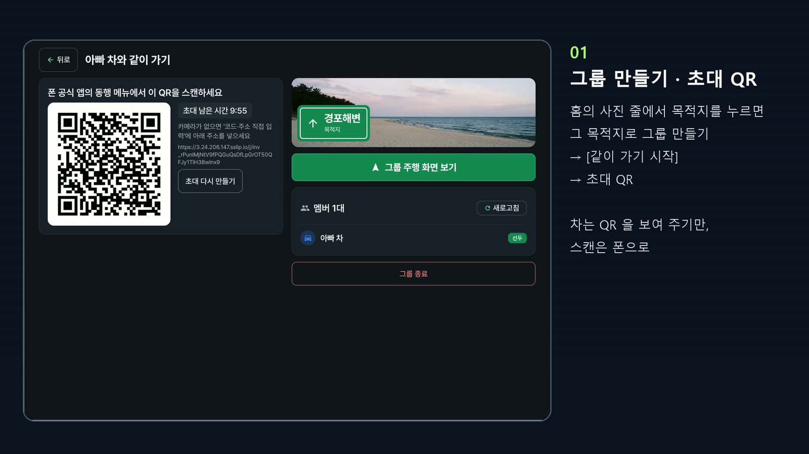<br><b>01 그룹 만들기 · 초대 QR</b><br><sub>홈의 사진 줄에서 목적지를 누르고 [같이 가기 시작] → 초대 QR. 차는 QR 을 보여 주기만 하고 스캔은 폰이 합니다.</sub></td>
    <td width="50%" valign="top">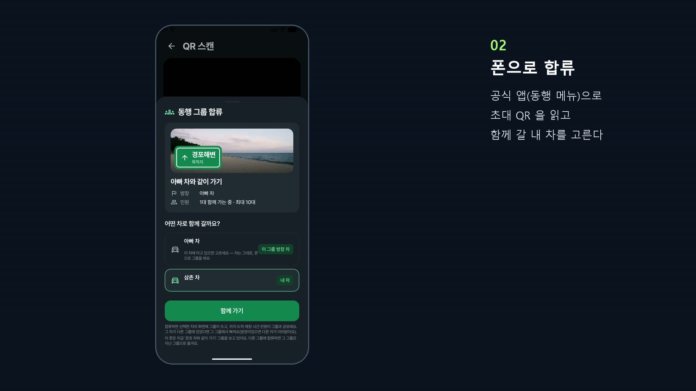<br><b>02 폰으로 합류</b><br><sub>폰 공식 앱의 동행 메뉴(시연용 <code>demo-host</code>)로 QR 을 읽고 함께 갈 내 차를 고르면 그 차 화면에 그룹이 뜹니다.</sub></td>
  </tr>
  <tr>
    <td width="50%" valign="top">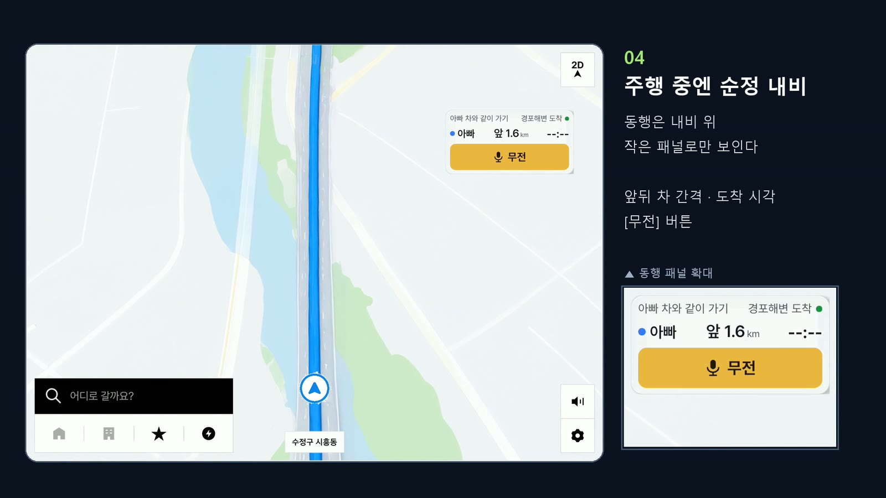<br><b>04 주행 중엔 순정 내비</b><br><sub>동행은 내비 오른쪽 위 작은 패널로만 보입니다 — 앞뒤 차 간격, 도착 시각, [무전].</sub></td>
    <td width="50%" valign="top">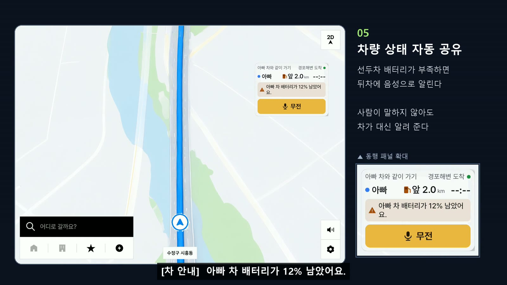<br><b>05 차량 상태 자동 공유</b><br><sub>선두차 배터리가 부족하면 뒤차 패널 소식 줄과 음성으로 알립니다("아빠 차 배터리가 12% 남았어요").</sub></td>
  </tr>
  <tr>
    <td width="50%" valign="top">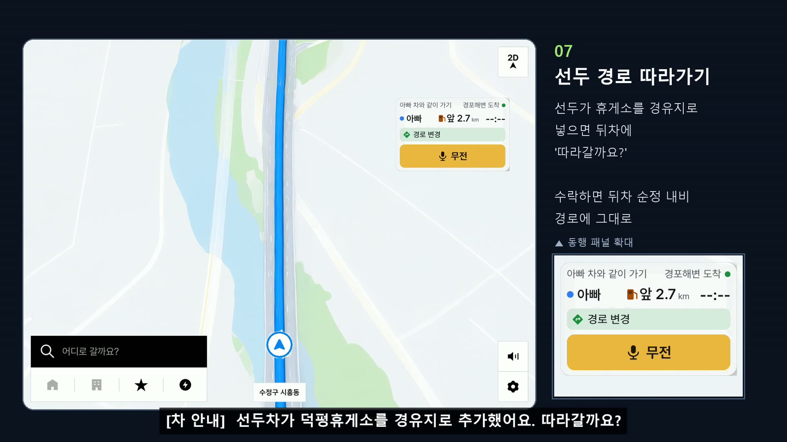<br><b>07 선두 경로 따라가기</b><br><sub>"선두차가 덕평휴게소를 경유지로 추가했어요. 따라갈까요?" 수락하면 뒤차 순정 내비 경로에 그대로 들어갑니다.</sub></td>
    <td width="50%" valign="top">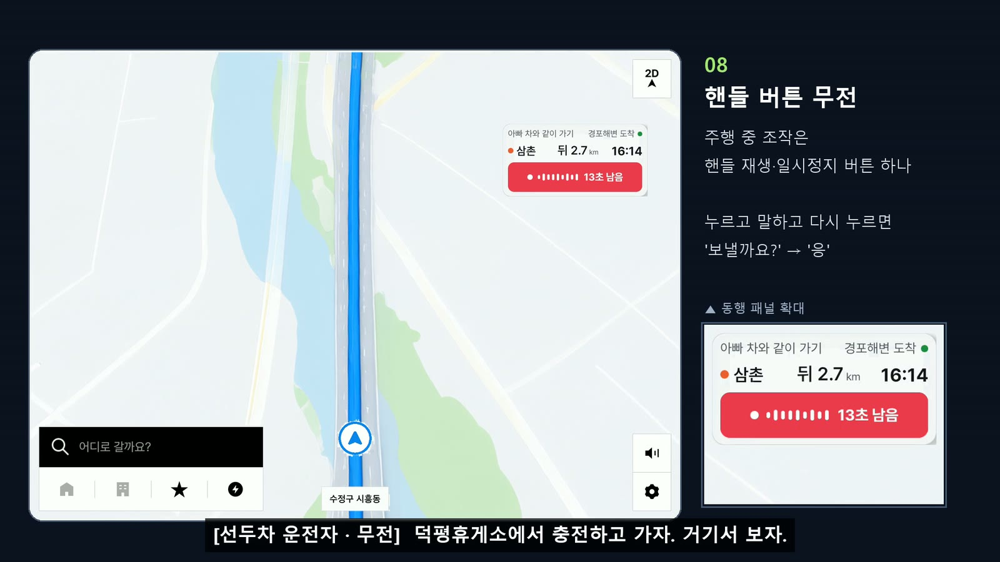<br><b>08 핸들 버튼 무전</b><br><sub>핸들 재생/정지 버튼을 누르고 말한 뒤 다시 누르면 "보낼까요?" — 음성으로 답하면 그룹 차에서 바로 재생됩니다.</sub></td>
  </tr>
  <tr>
    <td width="50%" valign="top">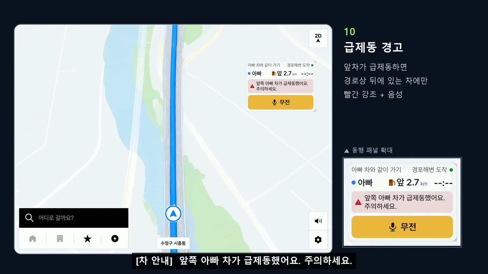<br><b>10 급제동 경고</b><br><sub>앞차가 급제동하면 경로상 뒤에 있는 차에만 빨간 강조 + 음성으로 알립니다.</sub></td>
    <td width="50%" valign="top">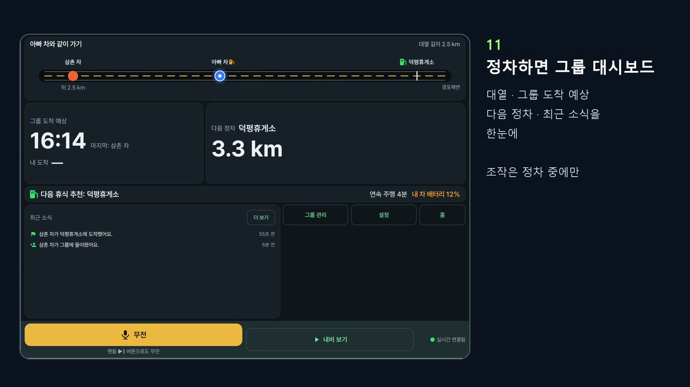<br><b>11 정차하면 그룹 대시보드</b><br><sub>대열 막대·그룹 도착 예상·다음 정차·최근 소식을 한눈에. 조작은 정차 중에만 합니다.</sub></td>
  </tr>
</table>

### 시연 영상

<p align="center">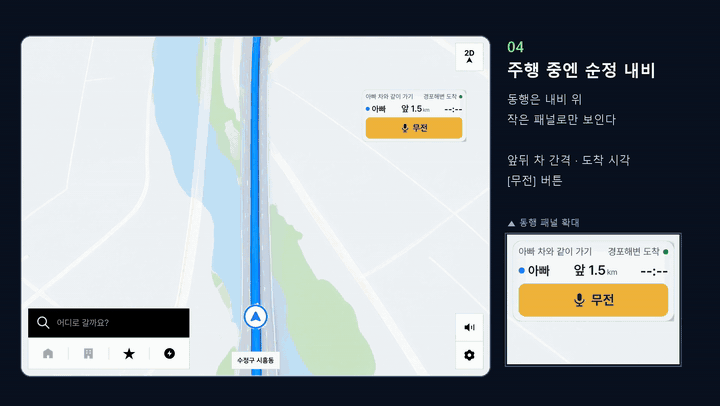</p>
<p align="center"><sub>시연 영상의 주행 구간(1:00~2:28)을 3배속 GIF 로 줄인 것.<br>내비 위 패널 → 저잔량 알림 → 동승자 메시지 → 선두 경로 따라가기 → 핸들 버튼 무전 → 휴게소 도착 알림 → 급제동 경고 순서입니다.</sub></p>

- 원본은 [`docs/video/DongHaeng_demo.mp4`](docs/video/DongHaeng_demo.mp4)(2분 42초)입니다. 그룹 만들기·폰 합류·동승자 합류부터 정차 대시보드까지 음성 안내와 자막이 함께 들어 있습니다.
- 폰이 없어도 차 홈의 **[예시 화면 둘러보기]** 로 정차 대시보드·내비 위 패널·급제동 강조·무전 화면을 예시 데이터로 볼 수 있습니다.

## 핵심 기능

| ID | 기능 | 내용 | 상태 |
|---|---|---|---|
| F1 | **QR 그룹 연결** | 선두차 화면의 초대 QR 을 폰 공식 앱(동행 메뉴)으로 스캔 → 함께 갈 차를 골라 합류 | 구현 |
| F2 | **차량 연결** | 차 화면 QR·6자리 코드를 폰으로 승인(Device Authorization Grant). 공식 앱 계정 연동은 서버 `ExternalTokenVerifier` 인터페이스로 준비 | 구현 |
| F3 | **실시간 위치·도착 예정 공유** | 내 차 기준 앞/뒤 간격, 그룹·내 차 도착 예정 시각 — 주행 중엔 내비 위 패널, 정차 중엔 대시보드 | 구현 |
| F4 | **차량 상태 공유** | 연료·배터리 저잔량, 급제동(경로상 뒤에 있는 차에만), 에어백 전개를 자동 전달 | 구현 |
| F5 | **이벤트 음성 안내** | 모든 소식을 TTS 로. 급제동·에어백은 빨간 강조, 음성이 늦으면 화면 먼저 | 구현 |
| F6 | **선두차 경로 동기화** | 선두가 경유지를 넣으면 뒤차에 "따라갈까요?" → 수락 시 NaviHelper 로 뒤차 내비 경로에 세팅 | 구현 |
| F7 | **도착·경유지 자동 알림** | 내비 도착 이벤트로 "휴게소 도착"·"목적지 도착"을 그룹에 공유 | 구현 |
| F16 | **무전(녹음형 PTT)** | 핸들 재생/정지 버튼 또는 화면 [무전] → 최대 15초 녹음 → "보낼까요?" 음성 확인 → 그룹 차에서 자동 재생 | 구현 |
| F11 | **동승자 폰 메시지** | 동승자가 폰에서 보낸 메시지를 그룹 차량이 TTS 로 읽음 | 구현 |
| F12 | **지연·끊김 처리** | 발생 시각으로 오래된 이벤트 음성 생략, 끊기면 마지막 속도·방향으로 위치 추정 | 구현 |
| F8~F10 | 원탭 프리셋 메시지 · 그룹 휴게소 자동 제안 · 대열 이탈 감지 | — | 2차 PT 전 과제 |
| F13~F15 | 가족 평소 모드 · 이동 기록 리포트 · B2B 대열 관리 콘솔 | — | 확장 계획 |

기능 정의와 우선순위는 [01 상세기획서](docs/01_상세기획서_PRD.md) §4, 화면별 동작은 [05 차량 앱 설계](docs/05_차량앱_설계.md)에 있습니다.

## 시스템 구조

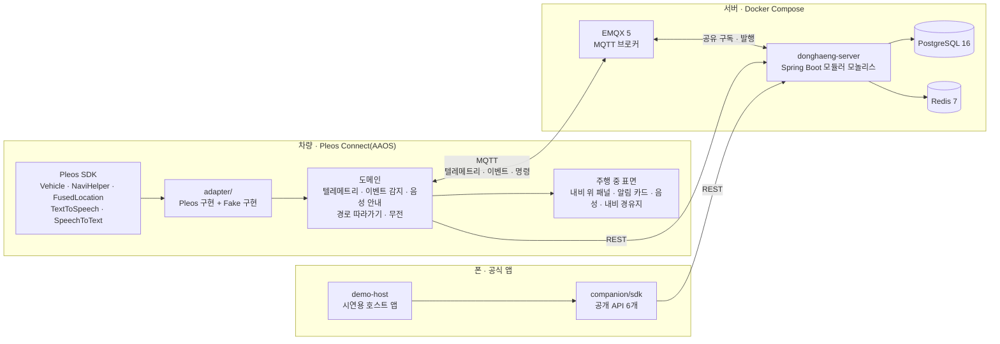

- **차량 앱:** Pleos SDK 타입은 `adapter/` 패키지 밖으로 나가지 않고, 밖에서는 도메인 타입(`Fix`·`Place`·`NaviEvent` 등)만 씁니다. 모든 어댑터는 Pleos 구현과 Fake 구현을 함께 두어(flavor `pleos` / `fake`) SDK 가 없어도 단위·통합 테스트가 돕니다.
- **서버:** 패키지(`identity`·`group`·`presence`·`event`·`routesync`·`insight`·`poi`·`notify`·`voice`·`mqtt`)가 미래의 마이크로서비스 경계입니다. 다른 패키지는 `*Api` 인터페이스로만 호출합니다.
- **실시간 경로:** 차량이 `dh/v1/vehicle/{vid}/telemetry`(1 Hz 위치)와 `…/event`(저잔량·급제동·도착)를 발행하면, 서버가 Redis 를 갱신해 2초마다 그룹 스냅샷 `dh/v1/group/{gid}/state` 를, 이벤트는 정규화·중복 제거 뒤 `dh/v1/group/{gid}/event` 로 내보냅니다.
- **지연·끊김:** 모든 메시지에 발생 시각을 싣습니다. 5초 넘은 이벤트는 음성을 생략하고, 위치는 최대 30초까지 추정하며, 재접속할 때마다 서버와 그룹 소속을 다시 맞춥니다.
- **클라우드:** 같은 compose 에 Caddy 를 얹어 VM 1대에 올렸습니다 — HTTPS 443, MQTT TLS 8883, 8883 이 막힌 망은 `wss://…/mqtt` 로 자동 전환합니다([infra/cloud/README.md](infra/cloud/README.md)).
- **폰:** `companion/sdk` 는 자체 로그인 화면·계정 저장이 없고 호스트 앱의 `TokenProvider` 로 토큰을 받습니다. 공개 API 는 `init`·`listMyVehicles`·`joinGroup`·`pairVehicle`·`sendPassengerMessage`·`observeGroup` 6개뿐입니다.
- **메시지 스키마:** `protocol/` 한 곳에만 정의하고 car-app·server·companion 이 함께 의존합니다.

**QR 합류 흐름**

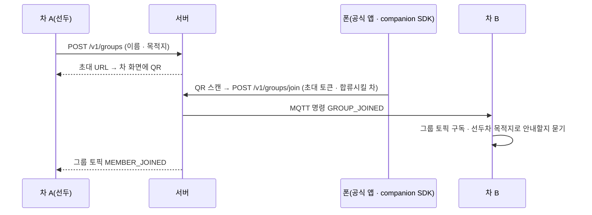

| 영역 | 사용 기술 |
|---|---|
| 차량 앱 | Kotlin 2.0.21, Jetpack Compose(BOM 2024.12.01), Hilt 2.53.1, Coroutines 1.9.0, Retrofit 2.11.0 · OkHttp 4.12.0, HiveMQ MQTT Client 1.3.4, ZXing 3.5.3, Vosk 0.3.75(오프라인 음성 인식), AGP 8.8.2, minSdk 28 |
| Pleos SDK | Vehicle 2.3.2, NaviHelper 3.0.5, FusedLocation 1.1.3, TextToSpeech 3.3.1, SpeechToText 3.3.1 |
| companion | Android 라이브러리(AAR, `explicitApi`) + 시연용 호스트 앱(CameraX 1.4.1 · ML Kit Barcode 17.3.0) |
| 서버 | Kotlin 2.0.21, Spring Boot 3.3.13(Web · Security · OAuth2 Resource Server · Data JDBC · Data Redis), Flyway V1~V7, Testcontainers 1.21.4, JDK 21 |
| 인프라 | PostgreSQL 16, Redis 7, EMQX 5.8, Docker Compose, Caddy(+ caddy-l4), AWS EC2 |

글꼴은 Pretendard(SIL OFL 1.1), 오프라인 음성 인식은 Vosk(Apache 2.0)입니다. 추천 목적지 사진 5장은 로컬 이미지 모델로 새로 만든 그림이며 실제 사진·타사 이미지가 아닙니다.

## Pleos SDK 활용

| SDK | 쓰는 곳 |
|---|---|
| Vehicle | EV 배터리·연료(저잔량), 브레이크·속도(급제동 판정), 기어(주행/정차), 방향지시등, 에어백 — 지원 여부를 먼저 확인하고 미지원 신호는 숨김 |
| NaviHelper | 현재 위치, 남은 거리·도착 예정, 회전 안내(카드가 회전 안내를 가리지 않게 300 m 게이트), 목적지·경유지 변경 감지(선두 경로 공유), 도착 이벤트, 경유지 포함 경로 요청(따라가기), 내비 화면 열기 |
| FusedLocation | 승인되면 위치 체인 맨 앞(없으면 NaviHelper → Android 위치로 자동 전환) |
| TextToSpeech · SpeechToText | 음성 안내의 대체 경로(Android TTS 가 없을 때 Pleos TTS ON_DEVICE), 무전 "보낼까요?"에 대한 "네/아니" 인식 1순위 |
| (Android) CarUxRestrictions · MediaSession | 주행 중 입력 제한, 핸들 미디어 버튼 |

- **먼저 확인하고 씁니다.** 기능을 쓰기 전에 `checkXxxCapabilities` 로 지원 여부를 보고, 미지원이면 화면에서 숨기고 로그만 남깁니다. 크래시는 내지 않습니다.
- **콜백은 흐름으로 감쌉니다.** SDK 콜백은 `callbackFlow` 로 감싸고 `awaitClose` 에서 같은 리스너로 해제합니다.
- **준비 중 SDK 에 의존하지 않습니다.** 가능하면 쓰고, 실패하면 다음 수단으로 자동 전환합니다.
  - 위치: (FusedLocation) → NaviHelper → Android LocationManager → Fake
  - 음성: Android `TextToSpeech`(ko_KR) → Pleos TextToSpeech SDK ON_DEVICE → 화면 표시만
  - 무전 확인: Pleos SpeechToText → Android 음성 인식 → 오프라인 Vosk → "5초 뒤 보낼게요" 카운트다운

## 검증 결과

| 항목 | 결과 |
|---|---|
| 시연 장면(Pleos 에뮬레이터 2대 + 클라우드) | 주행·저잔량·동승자 메시지·경로 따라가기·휴게소 도착·급제동 **10/10** |
| 무전 | 8개 시나리오 **75/75** |
| release APK(기본 서버 클라우드) | 등록·그룹 생성·폰으로 차 골라 합류·주행·메시지·무전 **12/12** |
| 30분 연속 실행 | 크래시·오류 0, MQTT 연결 유지 |
| 장애 복구 | 브로커 재시작 뒤 5~8초 재연결, 꺼져 있던 차가 켜지면 그룹 소속 자동 동기화, 망 끊김 뒤 토큰 자동 갱신 |
| 지연(한국 ↔ AWS 시드니) | 메시지 보냄 → 차 수신 P50 287 ms / P95 294 ms(로컬 서버 51 / 57 ms) |
| 자동 테스트 | 차량 앱 debug 641(fake) · 646(pleos), release 631(fake) · 636(pleos), 서버 173, 프로토콜 71, companion 177(sdk 102 + demo-host 75), 시연 스크립트 91 — 전부 통과 |
| 정밀 점검 | 코드 점검 확정 126건 반영(교차 검증 뒤), 기기 재검증 |

- 시연·실측 수치는 2026-11-03 기준이며 절차와 근거는 [09 테스트·데모 계획](docs/09_테스트_데모계획.md)에 있습니다.
- 자동 테스트 수는 마지막 실행 결과입니다(차량 앱·demo-host 2026-11-05, 서버 2026-11-03, 프로토콜·sdk 2026-11-02, 시연 스크립트 2026-11-10).

## 실행 방법

차량 앱은 **차 화면에 QR·코드를 보여 주기만** 하고, 스캔은 폰의 공식 앱(동행 메뉴 — 시연용 `demo-host`)이 합니다. 폰에서 QR 을 스캔한 뒤 적용할 차를 고르면 그 차에 반영됩니다.

**1. 서버** — 따로 띄울 필요가 없습니다. release 차량 앱·폰 시연 앱의 기본 서버는 클라우드 `https://3.24.206.147.sslip.io` 입니다.

**2. 차(Pleos Connect 에뮬레이터)** — 차량 APK 를 설치하고 플로팅 패널 권한을 줍니다(에뮬레이터에 설정 화면이 없어 adb 로 한 번).

```bash
adb install apk/DongHaeng_동행_release.apk
adb shell appops set --user 10 app.donghaeng.car SYSTEM_ALERT_WINDOW allow
```

권한이 없어도 동작합니다(내비 위 패널 대신 알림 카드 + 음성).

**3. 폰(휴대폰 AVD 또는 실기기)** — 폰 시연 앱을 설치하고 로그인합니다(설치마다 다른 시연 계정이 미리 채워져 있습니다).

```bash
adb install apk/DongHaeng_동행_폰시연앱_release.apk
```

**4. 차 등록** — 차 홈 [내 폰과 연결하기] → 차 화면에 QR·코드 → 폰 [QR 스캔] — 카메라가 없으면 '코드·주소 직접 입력'에 차 화면 코드 6자 → 차 이름 정하고 [등록] → 차 화면 '연결됨'.

**5. 같이 가기** — 차 홈 [같이 가기 시작] → 목적지 고르기 → 그룹 초대 QR → 함께 갈 다른 차의 운전자가 폰으로 스캔 → **합류시킬 차를 고르고** [함께 가기] → 그 차 화면에 그룹이 뜹니다.

**6. 주행** — 앞 화면은 순정 내비 그대로이고, 동행은 내비 위 작은 패널·음성으로 차 간격·도착 시각·급제동·저잔량·휴게소 도착·무전을 알립니다. 정차 중에는 [그룹 보기]로 대시보드를 봅니다.

<details>
<summary><b>카메라가 없을 때 QR 을 읽는 방법 세 가지</b> (카메라 없는 PC 의 에뮬레이터 등)</summary>

1. **[사진에서 QR 읽기]** — 스캔 화면에서 차 화면 QR 을 찍은 사진·스크린샷을 고릅니다. 에뮬레이터에 사진을 넣으려면:
   ```bash
   adb push <QR 캡처>.png /sdcard/Pictures/
   adb shell am broadcast -a android.intent.action.MEDIA_SCANNER_SCAN_FILE -d file:///sdcard/Pictures/<파일>
   ```
2. **링크로 열기** — 차 화면의 주소(`…/j/inv_…`·`…/pair?c=…`)를 메신저로 받아 누르면 이 앱이 바로 열립니다(Android App Links — 서버가 `/.well-known/assetlinks.json` 제공, 브라우저에서 열리면 [앱에서 열기]). 에뮬레이터에서는:
   ```bash
   adb shell am start -a android.intent.action.VIEW -d "<차 화면 주소>"
   ```
3. **코드·주소 직접 입력** — 차 화면의 코드 6자 또는 주소를 입력합니다.

</details>

<details>
<summary><b>폰이 없을 때</b></summary>

차 홈의 **[예시 화면 둘러보기]** 로 정차 대시보드·내비 위 패널·급제동 강조·무전 화면을 예시 데이터로 볼 수 있습니다.

</details>

<details>
<summary><b>로컬 서버로 돌리기</b></summary>

```bash
cd infra && docker compose up -d        # postgres · redis · emqx · server
```

차 설정 화면 제목을 5번 탭해 '서버 주소'를 `http://10.0.2.2:8080` 으로 바꿉니다(에뮬레이터 → PC). 서버를 바꾸면 폰에서 다시 연결합니다.

</details>

<details>
<summary><b>차 2대 자동 시연</b></summary>

차 2대 + 서버로 장면을 자동 실행하고 로그 확인표를 만드는 절차는 [09 테스트·데모 계획](docs/09_테스트_데모계획.md) §4 와 [`tools/demo/`](tools/demo/README.md)에 있습니다.

```bash
python tools/demo/demo.py --dry-run && python tools/demo/demo.py --email <dev 이메일>
```

</details>

### 직접 빌드

```bash
# 차량 앱 (JDK 17, Android SDK)
cd car-app && ./gradlew :app:assemblePleosRelease -PdhCloudHost=<서버 호스트>

# 폰 시연 앱
cd companion && ./gradlew :demo-host:assembleRelease -PdhCloudHost=<서버 호스트> -PdhDevLoginKey=<키>

# 서버 (JDK 21)
cd server && ./gradlew test bootRun
```

서명 정보 파일 경로는 `-PdhReleaseSigning=<경로>` 로 줍니다(없으면 서명 안 된 APK). 클라우드 배포는 [infra/cloud/README.md](infra/cloud/README.md)에 있습니다.

## 테스트 환경 및 필요한 설정

| 구분 | 환경 | 필요한 설정 |
|---|---|---|
| 차량 | Android Studio, **Pleos Connect Emulator v2.1.0 (API 34)**, minSdk 28 | 플로팅 패널 권한을 adb 로 한 번(위 2번). 없어도 알림 카드 + 음성으로 동작 |
| 폰(`demo-host`) | 휴대폰 AVD(예: Android Studio 기본 Medium Phone, API 35) 또는 실기기(Android 9+, 카메라) | 로그인 기본 이메일은 설치마다 다른 `judge-<8hex>@dev.local`. 카메라로 찍을 수 없으면 스캔 화면의 '코드·주소 직접 입력'에 차 화면의 6자리 코드(예: `KQ7-4MZ` — 차마다·매번 새로 만들어집니다)만 넣어도 됩니다(초대는 URL·`inv_…`) |
| 서버(클라우드) | Docker Compose — PostgreSQL 16, Redis 7, EMQX 5, Spring Boot 3.3 | 설정 없음. release 기본값 **`https://3.24.206.147.sslip.io`**, MQTT `ssl://3.24.206.147.sslip.io:8883`(8883 이 막힌 망은 `wss://3.24.206.147.sslip.io/mqtt` 로 자동 전환) |
| 서버(로컬) | 같은 compose | `infra/` 에서 `docker compose up -d` → 에뮬레이터는 `http://10.0.2.2:8080`(설정 제목 5번 탭 → '서버 주소') |
| 음성 | Pleos TTS 로 자동 동작 | 설정 없음 — 앱이 Android TTS → Pleos TTS SDK → 화면 표시 순으로 골라 진단 화면 '음성 안내' 카드에 표시합니다([예시 안내 듣기]로 확인). 더 좋은 음질을 원하면 [09 §1.4](docs/09_테스트_데모계획.md)의 오픈 소스 한국어 엔진(Supertonic 3)을 설치 |
| 빌드 | JDK 17(car-app·companion) / JDK 21(server) | 직접 빌드할 때만 |

## APK 파일 위치

`apk/` 폴더에 있습니다. 두 APK 모두 버전 1.0.0 이고 같은 키로 서명했습니다.

| 파일 | 설치 대상 | 내용 |
|---|---|---|
| [`apk/DongHaeng_동행_release.apk`](apk/DongHaeng_동행_release.apk) | 차 — Pleos Connect 에뮬레이터 | 동행 차량 앱(약 77 MB), 기본 서버 클라우드 |
| [`apk/DongHaeng_동행_폰시연앱_release.apk`](apk/DongHaeng_동행_폰시연앱_release.apk) | 폰 — 휴대폰 AVD 또는 실기기(Android 9+) | 공식 앱의 '동행' 메뉴를 재현한 시연용 호스트 앱(약 53 MB) + companion SDK |

서명·다시 만드는 방법은 [apk/README.md](apk/README.md)에 있습니다.

## 만들면서 부딪힌 것들

에뮬레이터 실측으로 확인하고 설계를 바꾼 기록입니다. 근거와 로그는 [10 리스크·확인 사항](docs/10_리스크_확인사항.md)에 있습니다.

<details>
<summary><b>1. 주행을 시작하면 앱 화면이 가려졌다</b></summary>

Pleos 에뮬레이터에서 속도가 0 을 넘으면 AAOS 가 앱 화면 대신 "주행 중에는 사용할 수 없습니다" 차단 화면을 띄웠습니다.
→ 주행 중 써야 하는 액티비티에 `distractionOptimized` 를 선언하고, `CarUxRestrictionsManager` 로 입력 UI 를 앱이 스스로 막습니다(R11).
</details>

<details>
<summary><b>2. 내비 위에 무엇을 띄울 수 있나</b></summary>

동행 화면과 순정 내비를 나란히 두는 분할은 되지 않았고, 런처 미니앱 자리는 시스템 서명 앱 전용이며, 내비 지도 위에 그리는 API 도 없었습니다. 알림은 category `navigation`·`msg`·`call` 만 내비 위 카드로 뜹니다.
→ "주행 중 앞 화면은 항상 순정 내비, 동행은 가리지 않는 표면으로만"으로 정리했습니다 — 플로팅 패널 + 음성, 권한이 없으면 5초 알림 카드(다음 회전 300 m 이내면 회전 뒤로), 지점은 내비 경유지로(R16).
</details>

<details>
<summary><b>3. 에뮬레이터에서 소리가 나지 않았다</b></summary>

시스템 TTS 엔진의 인텐트 필터에 category DEFAULT 가 없어 Android `TextToSpeech` 가 엔진을 찾지 못했습니다. Pleos TextToSpeech SDK 는 `Locale.KOREA`(ko_KR)로 줘야 ON_DEVICE 모드가 소리를 냈습니다.
→ 음성 체인(Android TTS → Pleos TTS SDK ON_DEVICE → 화면 표시만)을 만들고, 지금 경로가 연속 3번 실패하면 다음 경로로 내려갑니다. 엔진을 깔 수 없는 에뮬레이터에서도 소리가 납니다(R19).
</details>

<details>
<summary><b>4. 핸들 음성 버튼은 시스템 것이었다</b></summary>

핸들 음성 버튼(`VOICE_ASSIST`)은 시스템 비서가 가져가 앱에 오지 않았습니다. 대신 활성 `MediaSession` 이 있으면 재생/정지 버튼(`HEADSETHOOK`·`MEDIA_PLAY_PAUSE`·`MEDIA_PLAY`)을 순정 내비가 앞이어도 받을 수 있었습니다.
→ 그룹 주행 중이고 설정이 켜져 있을 때만 버튼을 받고, 다른 앱이 음악을 재생 중이면 양보합니다. 세션이 '재생 중' 미디어로 잡히지 않게 재생 상태는 PAUSED 로 둡니다(R14).
</details>

<details>
<summary><b>5. 앞차가 '앞쪽 급제동' 경고를 받았다</b></summary>

서버가 급제동을 그룹 전체에 보내고 차량 쪽은 내 차 것만 걸러서, 급제동한 차보다 앞에 있는 차도 경고를 받았습니다.
→ 서버가 스냅샷의 선두까지 거리로 **뒤차만** 수신 대상(`audience`)에 싣습니다. 직선 거리 근사라는 한계는 남아 있습니다(R18).
</details>

<details>
<summary><b>6. 차량 토큰이 사라졌다</b></summary>

시연 도중 차가 연결과 그룹을 잃었습니다. 원인은 서버가 아니라 확인 창 없이 눌리는 '연결 해제' 버튼이었습니다.
→ 확인 창 + 주행 중 비활성, 삭제 사유 기록, 저장소 읽기 실패 때는 세션을 지우지 않고 재시도, 토큰 자동 갱신을 넣었습니다(R13).
</details>

## 저장소 구조

```text
donghaeng/
├── car-app/              # Pleos 차량 앱 (Kotlin · Compose · Hilt) — flavor pleos / fake
│   └── app/src/main/kotlin/app/donghaeng/car/
│       ├── adapter/      # Pleos SDK 경계: vehicle · navi · location · voice · speech … (Pleos + Fake 구현)
│       ├── domain/       # telemetry · event · group · routesync · ptt · voice · session …
│       ├── surface/      # 주행 중 표면: 플로팅 패널 · 알림 카드 · 회전 게이트
│       ├── feature/      # 화면: home · pairing · creategroup · drive · groupdrive · settings …
│       └── service/ · core/ · di/ · ui/
├── companion/
│   ├── sdk/              # 공식 앱 내장 Android AAR — 공개 API 6개
│   └── demo-host/        # 공식 앱을 재현한 시연용 호스트 앱
├── server/               # Kotlin + Spring Boot 3.3 모듈러 모놀리스 (패키지 = 미래 마이크로서비스)
├── protocol/             # car-app · server · companion/sdk 공용 메시지 스키마 (kotlinx.serialization)
├── infra/                # docker-compose (postgres · redis · emqx · server) + cloud/ (Caddy · deploy.sh)
├── tools/demo/           # 시연 보조 스크립트 (GPX 재생 · Virtual Console · 장면 타임라인 · 무전 · 지연 측정)
├── docs/                 # 설계 문서 01~13, images/, video/
└── apk/                  # 제출용 release APK 2개
```

## 한계

- **에뮬레이터 검증입니다.** 실차에서는 확인하지 못했습니다. 핸들 버튼은 키 주입으로 검증했고 실차 키 배치는 확인이 필요하며, 실제 마이크 시험은 2차 PT 전 리허설에서 합니다.
- **에뮬레이터의 순정 내비 위치는 움직이지 않습니다.** 시연에서는 Android 위치(GPX 재생)로 차를 움직이고, 움직임은 동행 패널의 간격·소식·음성으로 보입니다. 실차에서는 NaviHelper 위치가 실제 위치입니다.
- **플로팅 패널 권한**을 줄 설정 화면이 에뮬레이터에 없어 adb 로 줍니다. 권한이 없으면 알림 카드 + 음성으로 자동 전환합니다.
- **공식 앱 내장은 OEM 협의가 필요한 가정입니다.** 시연은 공식 앱을 재현한 `demo-host` 와 dev 간편 로그인으로 하고, 공식 앱 OAuth 토큰 검증은 서버 `ExternalTokenVerifier` 인터페이스로 자리만 두었습니다.
- **급제동의 '앞뒤' 판정은 근사입니다.** 선두까지의 직선 거리로 판단해, 선두를 앞지른 차나 U자 도로에서는 틀릴 수 있습니다.
- **Pleos TTS ON_DEVICE 는 부하 시 시작이 5~9초 늦을 수 있습니다.** 그래서 급제동·에어백은 음성이 늦으면 화면 강조를 먼저 보입니다.
- **클라우드 서버가 AWS 시드니**라 왕복이 약 270 ms 입니다(메시지 P50 287 ms). 기능은 모두 동작합니다.
- **미구현:** F8(원탭 프리셋)·F9(그룹 휴게소 자동 제안)·F10(대열 이탈 감지)은 2차 PT 전 과제, F13~F15 는 확장 계획입니다.
- 서버 보안·정리의 알려진 한계는 [10 리스크·확인 사항](docs/10_리스크_확인사항.md) R20·R22 에 적었습니다.

## 문서 지도

| 알고 싶은 것 | 문서 |
|---|---|
| 무엇을·왜 만드나(문제, 페르소나, 기능 F1~F16, 사업성) | [01 상세기획서(PRD)](docs/01_상세기획서_PRD.md) · [12 기획서 제출본](docs/12_기획서_제출본.md) |
| 전체 구조·시퀀스(운영 설계와 MVP 매핑) | [02 시스템 아키텍처](docs/02_시스템아키텍처.md) |
| REST·MQTT 토픽·메시지 스키마(계약) | [03 API·프로토콜 명세](docs/03_API_프로토콜_명세.md) |
| DB DDL·Redis 키 | [04 데이터 모델](docs/04_데이터모델.md) |
| 차량 앱(Pleos SDK 어댑터, 주행 중 표면, UX 제한, 디자인) | [05 차량 앱 설계](docs/05_차량앱_설계.md) |
| 서버(패키지, 파이프라인, 보안) | [06 서버 설계](docs/06_서버_설계.md) |
| 공식 앱 내장 SDK(공개 API 6개, 인증, QR 처리, demo-host) | [07 companion 모듈 설계](docs/07_companion모듈_설계.md) |
| 마일스톤·작업 ID·일정 | [08 구현 계획서](docs/08_구현계획서.md) |
| 시연 시나리오·실측 기록 | [09 테스트·데모 계획](docs/09_테스트_데모계획.md) · [tools/demo/README.md](tools/demo/README.md) |
| SDK 제약·리스크·설명회 질문 | [10 리스크·확인 사항](docs/10_리스크_확인사항.md) · [13 설명회 요약](docs/13_설명회_요약_20261028.md) |
| 제출물 점검 | [11 제출 체크리스트](docs/11_제출체크리스트.md) |
| APK·서명 | [apk/README.md](apk/README.md) |
| 클라우드 배포·운영 | [infra/cloud/README.md](infra/cloud/README.md) |
| 개발 규칙 | [CLAUDE.md](CLAUDE.md) |

<div align="center">

**전화 없이, 한 대처럼.**

<sub>팀 DongHaeng</sub>

</div>
